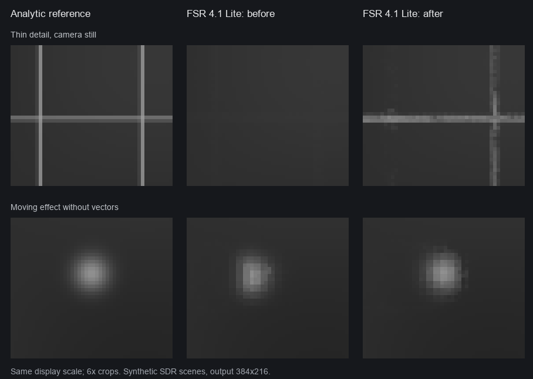

# FSR 4.1 Lite: качество и скорость — 14 октября 2026

Lite лучше сохраняет тонкие детали и обновляет эффекты без векторов движения
в проверенных сценах. Упрощённая сеть, её веса, округления и выбор кадров для
повторного использования сохранены. На Apple M5 медианное время апскейлера
практически совпало: **2,89 → 2,90 мс** при выключенном энергосбережении.

## Изменения

На кадрах, использующих сохранённый результат сети:

- История ограничивается диапазоном текущих цветов возле границ разного
  движения. На неподвижных участках и при равномерном движении сохраняются
  субпиксельные детали, которые текущий кадр может не содержать.
- Нулевой вектор движения больше не блокирует все обновления цвета.
  Проверяются выход истории за диапазон соседних образцов, достаточно большие
  и небольшие односторонние изменения, а также высокая уверенность сети.
- Отдельный `pre_reuse` исключает подготовку неиспользуемых входов сети и
  чтение recurrent-текстуры. Новых проходов или буферов нет. Старые шейдерные
  пакеты продолжают работать через общий `pre`.

Правила адаптированы по описаниям
[dll-2026-10-14](https://github.com/zgauthier2000/fsr4-shader-performance-overrides/releases/tag/dll-2026-10-14),
ревизия [9ab6457](https://github.com/zgauthier2000/fsr4-shader-performance-overrides/tree/9ab64571eda2d4f3a802b2b2e8c1bbe006da15da).
Это выборочное обновление независимой реализации на MIT-исходниках.
Полного переноса релиза или совпадения с Windows DLL не заявляется.
Политика упрощения сети остаётся от `dll-2026-10-07`; дополнительные изменения
весов, квантования, хранения движения и recurrent-memory не включены.
FSR 4.0 эти правки не затрагивают.

## Проверка изображения

Девять процедурных сцен: 32 кадра, 192×108 → 384×216. Эталон вычисляется
независимо интегрированием 8×8 образцов на пиксель. Первые восемь кадров и
граница в 12 пикселей исключены. PSNR считается по всем RGB-каналам при
SDR-пике 1; больше — лучше. Временная ошибка — средняя абсолютная ошибка
изменения цвета между соседними кадрами относительно эталона; меньше — лучше.

| Сцена | PSNR до, дБ | PSNR после, дБ | Изменение временной ошибки |
| --- | ---: | ---: | ---: |
| Неподвижные тонкие линии | 22,99 | 25,20 | +4,4% |
| Тонкие линии при движении камеры | 22,74 | 23,81 | −9,9% |
| Светлые частицы без векторов движения | 45,68 | 56,79 | −71,0% |
| Тёмные частицы без векторов движения | 55,02 | 61,83 | −56,1% |
| Неподвижная текстура | 54,61 | 54,70 | +0,5% |
| Слабое зерно | 43,43 | 43,56 | +0,4% |
| Сильное зерно | 36,39 | 36,53 | +0,2% |
| Тонкая неподвижная полоса поверх движущегося фона | 33,84 | 33,75 | +3,2% |
| Движущийся объект | 43,66 | 43,64 | +0,2% |



Улучшение не универсально: у неподвижных линий выросла точность, но немного
ухудшилась временная стабильность. Полоса поверх движущегося фона потеряла
0,10 дБ. Это диагностические сцены, а не оценка качества во всех играх.
На каждой сцене обе версии выполнили 16 расчётов сети и 16 повторных
использований; режим ускорения сохранился.

Также проверены четыре записанные игровые последовательности. Для них нет
эталонного рендера в выходном разрешении. Результаты обычных `exact` и
`exact-fast` до и после совпали побайтно на всех 64 проверенных RGBA-кадрах.

## Скорость без энергосбережения

Apple M5, macOS 27.0.1, питание от батареи, `lowpowermode=0` до и после
замера. Вход 864×560, выход 1712×1112, INT8 MPP, Auto Exposure, RCAS 0,401.
Одна и та же игровая последовательность из восьми кадров.

После предварительного прогрева выполнено шесть серий с меняющимся порядком
трёх вариантов. Каждый запуск включает один прогрев и 30 измеряемых
последовательностей: **1440 измеренных кадров на вариант**. История
сбрасывается в начале каждой последовательности; кадр сброса включён в
среднее. Измеряется полный GPU command buffer без счётчиков по проходам,
компиляции и диагностических копирований.

| Вариант | Медиана средних запусков, мс | Среднее всех запусков, мс | Диапазон средних, мс |
| --- | ---: | ---: | ---: |
| Lite до обновления | 2,894 | 2,898 | 2,870–2,951 |
| Lite после обновления | 2,900 | 2,985 | 2,881–3,373 |
| Обычный FSR 4.1 (`exact-fast`) | 4,118 | 4,145 | 4,057–4,316 |

Разница медиан Lite составляет +0,2%. В шестой серии новый Lite был заметно
медленнее; этот запуск сохранён в результатах. Частоты и температура GPU не
фиксировались, поэтому ускорение от самих правок по этим данным не заявляется.
Медиана кадров с повторным использованием снизилась с 1,641 до 1,623 мс,
но эта разница также мала относительно разброса.

По медианам Lite расходует примерно на 30% меньше GPU-времени, чем обычный
FSR 4.1. Это время апскейлера, не полного игрового кадра. Предыдущая серия
для обновлённого Lite с энергосбережением дала 6,02 мс: после его отключения
получилось около 2,1 раза быстрее. Предыдущие замеры были заметно шумнее.

Все серии, точные метрики качества, SHA-256 входных кадров и исходников,
а также результаты проверок сохранены в
[JSON-отчёте](reports/fsr411-m5-quality-2026-10-14.json).

## Проверки и повторение

Прошли `make test`, `test-fsr411-runtime`, `test-fsr411-lossy`,
`test-fsr411-cadence`, `test-fsr411-live`, `test-fsr411-simd`,
`test-fsr411-chroma`, `test-fsr411-cli` и `test-fsr411-snapshot`.
Проверены обычный Metal и Metal 4, сбросы истории, очереди кадров,
переключение профилей и границы буферов. Lossy QA: 12 конфигураций × 26
сценариев. SIMD проверен на M5; физических замеров на M1–M4 здесь нет.
Веса и native-параметры Lite для 1080/2160 в исходной рабочей версии
сравнены побайтно до и после; оба initializer-файла также сохранены.

Перед выпуском v1.6 проверки повторены после переноса на публичную `main`
от `crossover-v1.5` (`6806bfe`), включая тесты установщика. Все 96 игровых
RGBA-кадров трёх профилей совпали с проверенной рабочей сборкой. Существующие
установщик, генератор весов и SIMD Winograd сохранены; их версии и SHA-256
релизных исходников указаны в JSON-отчёте.

Генератор не требует игровых захватов, только Python и NumPy:

```sh
python3 tools/diagnostics/fsr411_quality_scenes.py generate build/quality-repro/input
tools/bin/fsr4mac build/quality-repro/input/wire_static build/quality-repro/after/wire_static --profile lossy --i8mpp
```

Для сравнения нужны выходные кадры обеих версий. Например, если прежние
результаты находятся в `build/quality-repro/before`:

```sh
python3 tools/diagnostics/fsr411_quality_scenes.py compare build/quality-repro/input build/quality-repro/before build/quality-repro/after --scenes wire_static --report build/quality-repro/comparison.json
```

Повторить один запуск производительности на сохранённом локальном захвате:

```sh
tools/bin/fsr4mac build/ghosting-diagnostics/replay-input/1791590816258-62446 build/quality-repro/bench --profile lossy --i8mpp --root "$PWD" --builddir build/quality-20261014/final-cache --no-compile --bench 30
```

Для старого Lite используется `before-cache`; для обычного FSR 4.1 —
`after-cache` и `--profile exact-fast`. Эти локальные кэши и игровые
захваты не входят в Git. Порядок всех запусков записан в JSON-отчёте.
